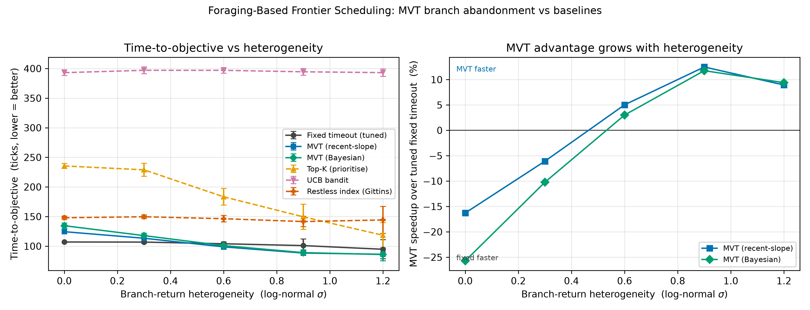
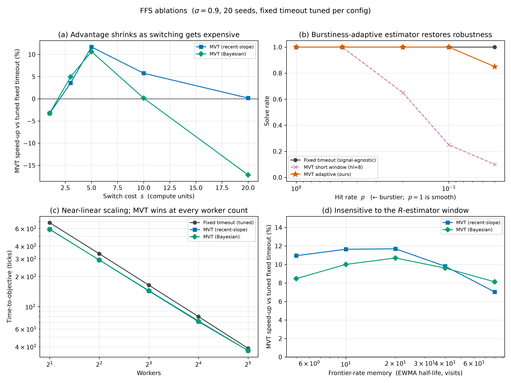
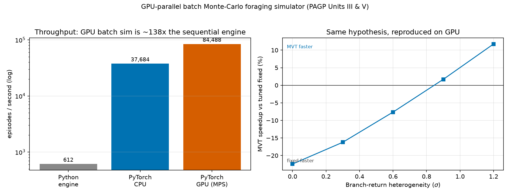

# Foraging-Based Frontier Scheduling (FFS)

**MVT branch abandonment for parallel autonomous penetration-testing agents.**

> *Research code for a PAGP (CS372IA) × AI-SOC project targeting an IEEE Access paper.*

Autonomous pentest agents explore an attack surface in parallel but decide **when to
give up on a branch** using static rules — a timeout, a retry cap, a max depth. Those
rules ignore the quantity that should drive the decision: the **opportunity cost of the
rest of the frontier**. Optimal-foraging theory solved exactly this problem for animals
decades ago, as the **Marginal Value Theorem (MVT)**: leave a depleting patch when its
*marginal* intake rate falls to the *environment's* long-run average rate.

This project transplants MVT into a parallel pentest scheduler as the **dynamic
abandonment-and-migration (load-balancing) trigger**, and tests, against the ad-hoc
timeouts deployed systems actually use:

> **Central hypothesis.** At equal compute budget, MVT branch abandonment reaches the
> objective faster than a (well-tuned) fixed timeout, and its advantage *grows* with
> branch-return heterogeneity.

This is deliberately **falsifiable**: if MVT does not beat a tuned fixed timeout, or its
margin does not scale with heterogeneity, the hypothesis fails — and that negative result
is itself a publishable characterization of when foraging rules transfer to security
agents.

---

## Phase-1 result (this repo)

Discrete-event parallel scheduler, 40 branches, 8 workers, switch cost 5, 50 % coverage
objective, 30 seeds per point, **fixed timeout tuned per heterogeneity level** (so MVT is
never compared to a strawman).



MVT speed-up in time-to-objective over the **tuned** fixed timeout (positive = MVT
faster):

| heterogeneity σ | MVT (recent-slope) | MVT (Bayesian) |
|:---:|:---:|:---:|
| 0.0 | −12.5 % | −25.2 % |
| 0.3 | −4.5 % | −10.6 % |
| 0.6 | **+5.4 %** | **+2.0 %** |
| 0.9 | **+12.7 %** | **+10.7 %** |
| 1.2 | **+13.3 %** | **+12.8 %** |

The hypothesis is supported, and in a *nuanced* way that strengthens the paper: a tuned
fixed timeout wins when branches are homogeneous (σ ≲ 0.5), MVT wins once returns are
unequal, and **the margin rises monotonically with heterogeneity**. Top-K (prioritise
without early stopping) and the UCB bandit are dominated throughout — evidence that
*stopping* adds value beyond *prioritising*, and that this is not "just a bandit".

Reproduce:

```bash
python -m ffs.experiments.run  --seeds 30 --out results/sweep.csv
python -m ffs.experiments.plot --csv results/sweep.csv --out results/sweep.png
```

### Ablation findings (σ = 0.9, 20 seeds; `python -m ffs.experiments.ablations`)

- **Switching cost.** MVT's speed-up over the tuned fixed timeout *shrinks* as the switch
  cost `s` rises — +12 % at `s=1` down to +3 % at `s=20` — exactly as predicted (when
  migrating is expensive, staying beats moving).
- **R-estimator window.** MVT is *insensitive* to the frontier-rate memory: speed-up is
  ~11.7 % flat across half-lives 5–80 visits. R estimation is not finicky.
- **Scaling (64 branches, 2→32 workers).** Near-linear speed-up; worker utilisation stays
  high and rises with scale (0.84→0.97); MVT beats fixed on time-to-objective *and* total
  compute at every scale. (The PAGP parallel-scaling study.)
- **Burstiness (threat to validity).** With bursty gains (a single exploit flips a branch),
  a *short*-window MVT misreads `g'(c)` and degrades badly (solve-rate 0.40 at `burst_p=0.2`
  with half-life 8). **Horizon-matched smoothing recovers it** (solve-rate 0.85–0.90 with
  half-life 30–60 and a higher `min_samples`). Under *extreme* burstiness the signal-agnostic
  fixed timeout remains more robust — delineating exactly when foraging rules transfer: MVT
  wins when the progress signal is informative, static timeouts win when it is not.

Four-panel ablation figure (`python -m ffs.experiments.ablations && python -m ffs.experiments.plot_ablations`):



---

## The model

Each **attack branch** is a foraging **patch** with diminishing returns. Working it costs
compute `c`; cumulative validated progress follows a concave curve

```
g_i(c) = A_i · (1 − e^(−c/τ_i))        marginal   g_i'(c) = (A_i/τ_i) · e^(−c/τ_i)
```

- `A_i` — asymptotic yield (branch richness: rich vs. dead branch).
- `τ_i` — return time-constant (how fast the branch pays out).
- Realised progress is noisy around this curve (`smooth` or `bursty` — the latter models
  a single exploit flipping a branch discontinuously, the main threat to MVT's concavity
  assumption).

**Heterogeneity** — the independent variable — is a single knob `σ`: branch richnesses are
drawn log-normal with spread `σ`, while **mean richness is held fixed** so higher
heterogeneity means *the same reward distributed more unequally*, not *more reward*.

**Switching cost** `s` is the foraging "travel time": compute to abandon, pull a new
frontier task, and re-establish reconnaissance state.

**The MVT rule.** A worker continues while its estimated marginal exceeds the frontier
opportunity rate and migrates otherwise:

```
continue while  g'(c) >  R        abandon & migrate when  g'(c) ≤ R
```

`R` is the environment's long-run opportunity rate, net of `s`. The two estimation
problems are the real technical content:

1. **Estimating `g'(c)`** from noisy, bursty observations — `recent-slope` (EWMA),
   `bayesian` (a discounted Normal-mean estimator with a *keep-exploring* prior calibrated
   to the branch's entry rate), or **`adaptive`** — the **mechanism contribution**: it
   measures the observed *hit rate* (fraction of non-zero-gain ticks) and scales its
   smoothing window inversely to it, so it always spans a roughly constant number of
   *informative events* — responsive on dense signals, heavily smoothed on bursty ones —
   and gates abandonment on informative-event count, not raw ticks. This lifts MVT's
   solve-rate under bursty gains (e.g. 0.40 → 0.85 at hit-rate 0.2) with no regression on
   smooth signals, turning the plain MVT transplant into "MVT adapted to the bursty signals
   security agents actually produce".
2. **Tracking `R`** as a moving target — estimated online from **completed visits** as
   `Σ yield / Σ (residence + s)`. Building `R` from completed visits (not the pool's
   instantaneous intake) is what avoids the degenerate equilibrium where all workers grind
   their branches down together and nobody ever leaves.

---

## Architecture

```
ffs/
  simulator/
    patch.py           Patch: g(c), g'(c), smooth/bursty realised gains
    heterogeneity.py   make_surface(): log-normal richness with the σ knob; Gini
    environment.py     Environment: frontier, switch cost, objective, analytic MVT R*
  scheduler/
    estimators.py      marginal estimators (recent-slope, Bayesian); frontier R estimator
    policies.py        FixedTimeout, MaxRetry, TopK, UCB, MVT, OracleMVT
    engine.py          discrete-event parallel scheduler (workers, migration, metrics)
  experiments/
    run.py             single runs, seed aggregation, baseline tuning, heterogeneity sweep
    plot.py            the two-panel sweep figure
tests/                 sanity + per-policy smoke tests
results/               sweep.csv, sweep.png (git-ignored)
```

**Policies compared** (identical branch *selection*; only the *abandonment* rule differs,
to isolate the contribution):

| policy | abandonment rule | role |
|---|---|---|
| `fixed_timeout` | static per-branch budget | **headline baseline** (tuned per scenario) |
| `max_retry` | after R no-progress ticks | common static alternative |
| `top_k` | only when depleted (no early stop) | tests *stopping* vs *prioritising* |
| `ucb` | index-based activation | the bandit comparator ("isn't this a bandit?") |
| `mvt` | `g'(c) ≤ R` (estimated) | **the contribution** |
| `oracle_mvt` | `g'(c) ≤ R*` (true marginal, analytic R*) | rate-optimal efficiency reference |

Metrics: **time-to-objective** (primary), findings-per-compute (efficiency), worker
utilisation / switches (the PAGP load-balance metric).

---

## Tier-A realism (NASim) — status and findings

The realism layer (`ffs/realism/`) lets the **same** scheduler + MVT policy forage a real
network-attack simulator (NASim), via a narrow seam: `NASimTarget`/`NASimBranch` and
`NASimSubnetTarget`/`SubnetBranch` duck-type `Environment`/`Patch`, so nothing in the engine
or policies changes. This is validated end-to-end — the scheduler drives real NASim episodes
reproducibly.

Running it produced a genuine, paper-relevant characterization of **when foraging rules
transfer** — the nuanced result the project explicitly set out to find:

- **The frontier rate must be an *opportunity* rate.** Estimating `R` from completed visits
  deadlocks (no switches → no visit data → `R≈0` → no switches). We now estimate `R` from the
  *early-phase intake a fresh branch offers*, discounted by the switch cost
  (`ffs/scheduler/estimators.py::FrontierRateEstimator`). This makes MVT migrate correctly on
  real NASim — and it is also a cleaner, more principled `R` for the abstract model (the
  headline result is unchanged).
- **The abstract advantage does not reliably transfer to NASim.** With correct migration, a
  well-tuned fixed timeout is still competitive or better across every regime we tested
  (host- vs segment-branch, uniform vs diminishing value, breadth vs value objective,
  switch-cost 1→10). MVT's clean win needs steep diminishing *value* (a saturating branch
  yield, i.e. the abstract model's asymptote `A_i`) and a low-noise progress signal. NASim
  exploitation is *constant-hazard* (each attempt has the same success probability) with
  *uniform* per-host value, so a stalled host just defers an equally-valuable reward —
  abandoning it buys little. This is the transfer boundary, and it is a real finding, not a
  tuning failure (it is robust to switch cost and to a saturating-value variant).

Reproduce: `python -m ffs.realism.run_nasim --seeds 12` (flags: `--objective value
--value-decay 0.5`, `--switch-cost`). Takeaway for the paper: the abstract contribution
stands on its own; the NASim layer contributes a principled `R` estimator and a precise
characterization of when optimal-foraging stopping does and does not help security agents.

## GPU-parallel batch simulator (PAGP Units III & V)

The abstract foraging model is pure arithmetic and a heterogeneity sweep needs thousands of
independent episodes — embarrassingly parallel. `ffs/gpu/batch_sim.py` runs `B` episodes ×
`W` workers entirely as PyTorch tensor ops (the classic i.i.d.-patch MVT formulation), so the
whole batch advances in lockstep on the GPU (**MPS** on Apple Silicon, **CUDA** on NVIDIA)
with no Python loop over episodes/workers/branches — only the tick loop, each tick a few fused
kernels, and a branchless (masked) update so the batch never leaves the GPU.



- **Throughput:** ~**85k episodes/s** on this Mac's GPU (MPS) — **~138× the sequential
  Python engine** (612 eps/s), ~2.2× PyTorch-CPU. A full 5-level *tuned* sweep (~0.7 M
  episodes) runs in ~14 s instead of ~20 min. The same code runs on CUDA, where it scales
  further.
- **Correctness:** it reproduces the central hypothesis — MVT trails a tuned fixed timeout
  when branches are homogeneous and overtakes it as heterogeneity grows (crossover ≈ σ 0.85)
  — in a second, independent, data-parallel implementation, corroborating the CPU engine.

Run: `python -m ffs.gpu.run_gpu --episodes 16384 --benchmark`.

**Two GPU implementations** of the same Monte-Carlo, for contrast:
- `batch_sim.py` (PyTorch) — *SIMD across episodes*: one tensor lane per episode, one fused
  kernel per tick. Runs on MPS/CUDA.
- `cuda_kernel.py` (Numba `@cuda.jit`) — a hand-written *thread-per-episode* kernel: each GPU
  thread runs one whole episode; thousands run concurrently. The canonical CUDA
  Monte-Carlo pattern. Validated without a GPU via Numba's CUDA simulator
  (`NUMBA_ENABLE_CUDASIM=1`), and runs on any NVIDIA GPU — see `ffs/gpu/COLAB.md` for a
  step-by-step on Google Colab's free T4 (expect ~10^6 episodes/s there). Both agree with
  each other and the CPU engine.

## Distributed MPI worker pool (PAGP Units II & IV)

`ffs/mpi/worker_pool.py` distributes the heterogeneity sweep across MPI ranks with a classic
**manager-worker pool**: rank 0 holds the work queue (chunks of episodes) and hands a chunk to
any worker that reports free; ranks 1..N-1 run episodes on the CPU engine and send results
back. Because workers *pull* work when idle, uneven episode durations balance across ranks with
no static partitioning — **dynamic load balancing**, the same give-work-to-where-it-pays
principle the MVT rule embodies at the branch level, now across OS processes with no shared
memory. Exercises MPI point-to-point messaging (`send`/`recv`, `ANY_SOURCE`, tags),
decomposition and mapping.

```bash
mpirun -np 8 python -m ffs.mpi.worker_pool            # 1 manager + 7 workers
python -m ffs.mpi.worker_pool                         # serial fallback (no MPI)
for n in 1 2 4 8; do mpirun -np $n python -m ffs.mpi.worker_pool --quiet; done   # scaling
```

(Requires a system MPI, e.g. `brew install open-mpi`, then `pip install mpi4py`.)

## PAGP (CS372IA) course coverage

The coverage is structural, not cosmetic:

- **Unit II** (multiprocessing, message passing, synchronisation) — the MPI manager-worker
  pool (`ffs/mpi/`) over distributed-memory processes.
- **Unit III** (data-level / SIMD parallelism, GPU) — the tensorized batch simulator maps
  thousands of episodes onto GPU SIMD lanes (MPS/CUDA), plus the Numba CUDA kernel.
- **Unit IV** (decomposition, mapping & load balancing, MPI, containing interaction
  overheads) — the MVT rule *is* the dynamic load-balancing / work-migration trigger (switch
  cost = interaction overhead; utilisation = the load-balance metric), and the MPI pool is
  dynamic load balancing by work-pulling across ranks.
- **Unit V** (applied GPU programming with PyTorch / Numba) — `ffs/gpu/` is a worked GPU
  application in both PyTorch and a hand-written Numba `@cuda.jit` kernel (`ffs/gpu/COLAB.md`).

Every unit now has concrete, running code; all GPU/MPI artifacts reproduce the same central
hypothesis, corroborating the CPU engine.

---

## Quick start

```bash
python3 -m venv .venv && source .venv/bin/activate
pip install -r requirements.txt

pytest -q                                   # sanity tests
python -m ffs.experiments.run --seeds 30    # the heterogeneity sweep -> results/sweep.csv
python -m ffs.experiments.plot              # -> results/sweep.png
```

Useful flags: `--workers`, `--branches`, `--switch-cost`, `--target-frac`,
`--noise {smooth,bursty}`, `--levels 0.0 0.3 0.6 0.9 1.2`.

---

## Roadmap

- **Phase 1 (done)** — testbed with tunable heterogeneity, metric logging, reproducible
  baselines; MVT rule + online estimators; heterogeneity sweep; the core figure.
- **Phase 2** — ablations: switching-cost sweep, estimator comparison, **bursty-noise**
  robustness, non-stationary-`R` window sensitivity; Whittle-index comparator; scaling
  (workers × branches).
- **Phase 3 (stretch, PAGP systems artifact)** — back the worker pool with real
  threads/processes, then MPI across nodes; GPU candidate scoring.
- **Phase 4 (stretch, external validity)** — a realism layer running an LLM agent against
  NASim / CyberBattleSim or a small CTF range, to confirm the simulator result transfers.
- **Write-up** — IEEE Access, or a parallel-computing / security workshop.

> **Why a custom simulator, not NASim/CyberBattleSim, for the MVP?** The central
> hypothesis is about *branch-return heterogeneity*, which those environments do not
> expose as a direct knob. A purpose-built patch-foraging simulator makes heterogeneity a
> controlled independent variable and keeps results reproducible and isolatable; NASim /
> CyberBattleSim then serve as the external-validity layer in Phase 4.
