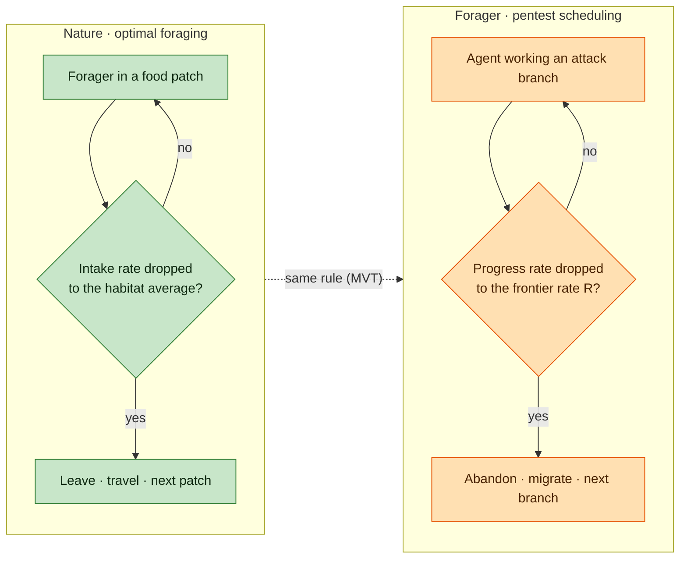
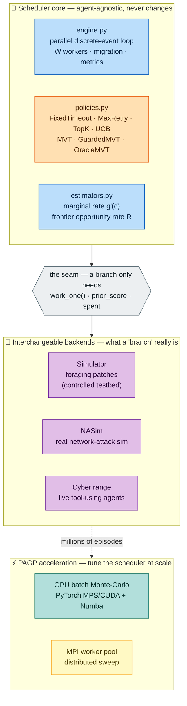
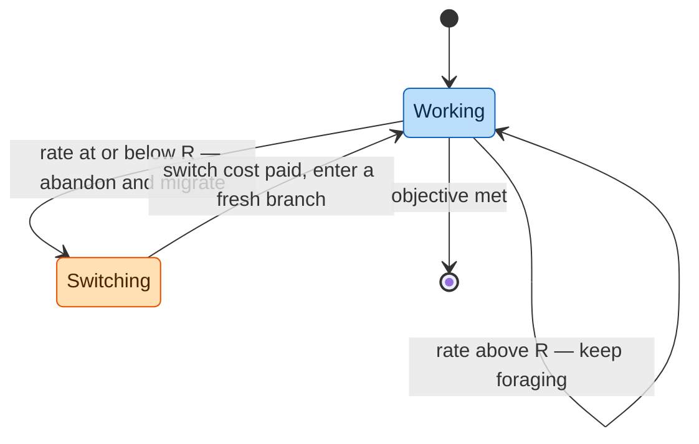
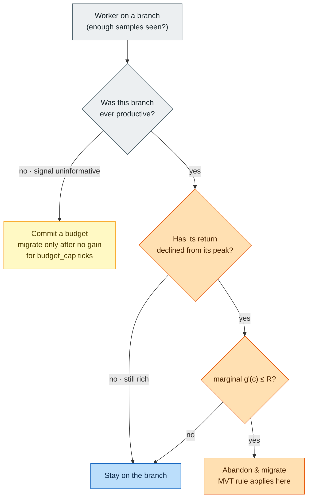
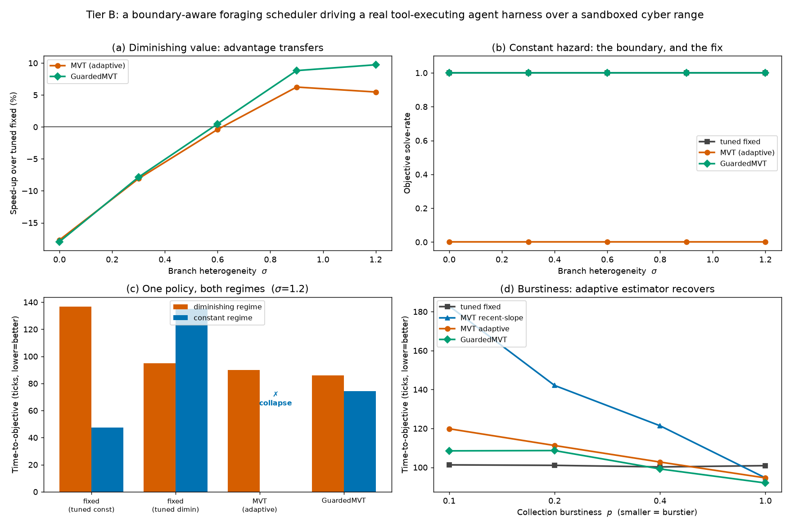
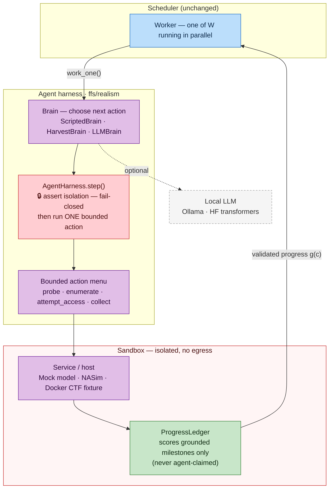
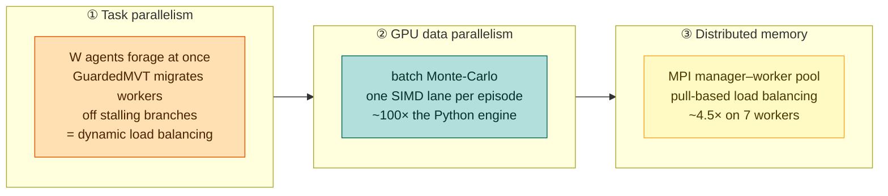

# Forager

**Optimal-foraging scheduling for parallel autonomous pentest agents — it knows when to walk away.**

> Research code for **PAGP (CS372IA) × AI-SOC**, targeting an IEEE Access paper.
> Python package: `ffs/` (*Foraging-based Frontier Scheduling*).

---

## TL;DR

A pool of autonomous pentest agents attacks many branches of a target *in parallel*. The hard
question each agent faces is **"when do I give up on this branch and go somewhere better?"**
Deployed systems answer with a dumb timeout. **Forager** answers with a 50-year-old rule from
biology — the **Marginal Value Theorem (MVT)** — and shows exactly when that rule wins, when it
doesn't, and a **boundary-aware version (`GuardedMVT`) that is never badly wrong**.

| What we claim | Evidence |
|---|---|
| MVT beats a *tuned* timeout when branches are unequal, and the gap grows with inequality | abstract sweep: **−12% → +13%** as heterogeneity σ rises (crossover ≈ σ 0.6) |
| The advantage transfers to a **real tool-using agent harness** | Tier-B live harness: same crossover, **+9.7%** at σ = 1.2 |
| Plain MVT has a sharp **failure mode** (constant-hazard targets) | its solve-rate **collapses to 0** there |
| `GuardedMVT` keeps the win **and** removes the failure | solves **both** regimes with **one** config; the only policy that does |
| It's a genuine **parallel-computing** project (PAGP) | GPU batch sim **~100×** the Python engine; MPI pool **~4.5×** on 7 workers |

---

## The problem, in 30 seconds

```
Agent exploring an attack surface, in parallel with others:

   branch A ───▶ paying off well      ← keep going?
   branch B ───▶ gone quiet           ← give up and move?
   branch C ───▶ untouched, looks rich ← worth switching to?
```

A static **timeout / retry-cap / max-depth** ignores the one thing that should drive the
decision: the **opportunity cost of the rest of the frontier**. Leaving a quiet branch is only
smart if somewhere better is waiting — and how good "elsewhere" is changes as the engagement
unfolds.

## The idea: borrow a rule from biology

Animals solved this exact trade-off long ago. The **Marginal Value Theorem** says: *leave a
depleting patch the moment its marginal intake rate drops to the habitat's long-run average
rate.* Forager transplants that into scheduling.



> **Central hypothesis (falsifiable).** At equal compute, MVT branch-abandonment reaches the
> objective *faster* than a well-tuned fixed timeout, and its advantage *grows* with
> branch-return heterogeneity. If it doesn't, that negative result is itself a publishable
> map of *when* foraging rules transfer to security agents.

---

## How it's built

One **agent-agnostic scheduler** drives several interchangeable **backends** through a narrow
seam. The scheduler never knows whether a "branch" is a math model, a network simulator, or a
live agent attacking a container — so the *same* code produces every result in this repo.



### The model (one line of math)

Each attack branch is a foraging **patch** with diminishing returns. Working it for compute `c`
yields cumulative validated progress

```
g(c) = A · (1 − e^(−c/τ))        marginal rate   g'(c) = (A/τ) · e^(−c/τ)
```

- **`A`** — how rich the branch is (total progress available). **`τ`** — how fast it pays out.
- **Heterogeneity `σ`** (the independent variable) — branch richnesses are drawn log-normal with
  spread `σ`, **mean held fixed**, so bigger σ = *same reward, more unequally distributed*.
- **Switch cost `s`** — the "travel time": compute to drop a branch and re-establish recon elsewhere.

---

## How a worker decides

Each of the `W` parallel workers is always in one of three states. The policy controls exactly
one decision — **when to abandon** — and everything else is held identical across policies, so
the comparison is fair.



The MVT rule is just: **continue while `g'(c) > R`, abandon when `g'(c) ≤ R`**, where `R` is the
frontier's opportunity rate (net of the switch cost). The real technical work is *estimating*
two noisy things online:

1. **the branch's marginal `g'(c)`** — via `recent_slope` (EWMA), `bayesian`, or **`adaptive`**,
   the mechanism contribution: it measures the signal's *hit-rate* and widens its smoothing
   window on bursty signals, so it tracks a constant number of *informative events* rather than
   raw ticks. (Lifts MVT's solve-rate under bursty gains, e.g. **0.40 → 0.85**, with no
   regression on smooth signals.)
2. **the frontier rate `R`** — from the *early-phase intake a fresh branch offers*, discounted by
   `s`. (Estimating it from completed visits instead causes a deadlock where nobody ever leaves.)

### GuardedMVT — knowing *where* the rule applies

MVT is only valid when a branch's return actually **diminishes**. On a *constant-hazard* target
(every attempt equally likely to succeed, e.g. brute-forcing one host), the marginal signal is
uninformative and plain MVT abandons too early — catastrophically. `GuardedMVT` detects the
regime **online, per branch**, and only trusts the MVT rule where it's earned:



---

## Does it actually work? Three levels of proof

The same scheduler is validated at increasing realism: **abstract math → network simulator →
live tool-using agents.** Agreement across all three is the external-validity story.

### 1 · Abstract simulator — the headline

40 branches, 8 workers, switch cost 5, 50% coverage objective, 30 seeds, **fixed timeout tuned
per heterogeneity level** (never a strawman).


MVT speed-up over the *tuned* fixed timeout (positive = MVT faster):

| heterogeneity σ | 0.0 | 0.3 | 0.6 | 0.9 | 1.2 |
|---|:--:|:--:|:--:|:--:|:--:|
| **MVT speed-up** | −12.5% | −4.5% | **+5.4%** | **+12.7%** | **+13.3%** |

A tuned timeout wins when branches are alike (σ ≲ 0.5); **MVT wins once they're unequal, and the
margin rises monotonically.** Top-K (prioritise, never stop early) and a UCB bandit are dominated
throughout — evidence that *stopping* adds value beyond *prioritising*. *(Ablations:
`results/ablations.png` — switch-cost sensitivity, estimator comparison, scaling, burstiness.)*

### 2 · NASim — a real network-attack simulator

The same scheduler drives real NASim episodes. Finding: **the advantage does not transfer
unconditionally.** A tuned timeout stays competitive because NASim exploitation is
*constant-hazard* with *uniform* host value — so stalling just defers an equally-valuable
reward. This **transfer boundary** is a real, robust result (and it motivated `GuardedMVT`).

### 3 · Live agent harness (Tier B) — the real-tool test

Now a branch is a **service**, one unit of compute is one **bounded agent action**, and progress
is scored only from **observed** state. The results reproduce the full story *with real tooling*:

| regime | tuned fixed | plain MVT | **GuardedMVT** |
|---|:--:|:--:|:--:|
| diminishing value, σ = 1.2 | baseline | +5.5% | **+9.7%** |
| constant hazard | solves | **✗ collapses (0%)** | **solves 100%** |

**One policy must handle an *unknown* regime** — and only `GuardedMVT` does (time-to-objective at
σ = 1.2, lower = better):

| policy (single config) | diminishing | constant |
|---|:--:|:--:|
| fixed timeout, tuned for *constant* | 137 | **46** |
| fixed timeout, tuned for *diminishing* | 95 | 135 |
| plain MVT | 90 | **✗ collapse** |
| **GuardedMVT** | **86** | **74** |



#### The agent harness, up close

Tier B is deliberately **framework-free and NDA-clean**: a tiny custom harness, not LangChain/
AutoGPT. The scheduler is the orchestrator; a per-branch **brain** (scripted, or a real LLM)
picks the next action; the **harness** enforces isolation and runs it; progress is **grounded**
in observed state, never in what the agent *claims*.



**Safety by construction:** isolation is asserted before *every* action and **fails closed**;
the action set is bounded and non-weaponised; the live Docker range sits on an internal,
**no-egress** network and holds no real data. Full gate in [`ffs/realism/TIERB.md`](ffs/realism/TIERB.md).

---

## The PAGP angle (parallel architecture & GPU)

This is a parallel-computing project end to end — three kinds of parallelism, all running:



- **GPU batch simulator** (`ffs/gpu/batch_sim.py`) — thousands of episodes run as PyTorch tensor
  ops, one SIMD lane per episode, on **MPS (Apple Silicon)** or **CUDA**. **~85–120k episodes/s**,
  **~100× (up to ~140×) the sequential Python engine** — a full tuned sweep in seconds, not
  minutes. A second **Numba `@cuda.jit`** kernel (`ffs/gpu/cuda_kernel.py`) runs the same
  Monte-Carlo thread-per-episode on CUDA (`ffs/gpu/COLAB.md`). Both reproduce the headline.
  
- **MPI worker pool** (`ffs/mpi/worker_pool.py`) — a manager hands episode chunks to whichever
  rank is free (work-*pulling*), so uneven durations balance with no static partitioning — the
  same give-work-to-where-it-pays principle MVT uses at the branch level, now across processes.

| PAGP unit | Where it lives |
|---|---|
| **II** · message passing, synchronisation | MPI manager–worker pool (`ffs/mpi/`) |
| **III** · data-level / SIMD, GPU | tensorized batch sim + Numba CUDA kernel (`ffs/gpu/`) |
| **IV** · decomposition, mapping & **load balancing** | MVT *is* the work-migration trigger; MPI pool is pull-based balancing |
| **V** · applied GPU with PyTorch / Numba | `ffs/gpu/` (both implementations) |

---

## Live demo — see it work

A narrated run of `W` LLM agents foraging the range in parallel under `GuardedMVT`:

```bash
python -m ffs.realism.demo_llm                # auto: a local Ollama model, else scripted fallback
python -m ffs.realism.demo_llm --backend scripted   # no LLM — always runs
```

It prints, live: each agent **ENTER**ing a branch → actions chosen by the model →
**ABANDON → MIGRATE** (the parallel load-balancing moment) → **crown-jewel flag captured**, then
the measured GPU numbers (batched inference + the ~100× batch Monte-Carlo). With no model it
falls back to the scripted brain, so it never fails in front of an audience.

---

## Repo map

```
ffs/
  simulator/     patch.py · heterogeneity.py · environment.py     the controlled foraging model
  scheduler/     engine.py · policies.py · estimators.py          the agent-agnostic core (the science)
  experiments/   run.py · ablations.py · plot*.py                 sweeps, ablations, figures
                 camera_ready.py · stats.py · tables_cr.py        camera-ready study, statistics, paper tables
                 plot_cr.py                                       camera-ready (vector) figures
  realism/       cyber_range.py · agent_harness.py · sandbox.py    Tier-B live harness + the seam
                 services.py · progress.py · llm_backends.py       grounded progress + LLM backends
                 nasim_target.py · brains.py                       Tier-A NASim integration
                 demo_llm.py · TIERB.md                            the live PAGP demo + safety gate
                 llm_agent.py · cr_llm_eval.py                     LLM brains (Ollama) + their evaluation
                 cr_safety.py · run_live_eval.py                   safety-control tests + containerised range
  gpu/           batch_sim.py · cuda_kernel.py · COLAB.md          GPU batch Monte-Carlo (MPS/CUDA/Numba)
  mpi/           worker_pool.py                                    distributed sweep (MPI)
docker/          flagsvc/ · docker-compose.yml                     isolated, no-egress CTF fixture
                 eval/make_eval_range.py                           heterogeneous 12-container evaluation range
paper/atis2026/  main.tex · main.pdf · tables/ · figs/             ATIS 2026 camera-ready paper
tests/           47 tests (1 CUDA-gated)
results/         *.png figures · *.csv data
  cr/            camera-ready per-seed data, statistics, LLM reply memos
```

---

## Quick start

```bash
python3 -m venv .venv && source .venv/bin/activate
pip install -r requirements.txt

pytest -q                                    # sanity tests
python -m ffs.experiments.run  --seeds 30    # abstract sweep      -> results/sweep.csv
python -m ffs.experiments.plot               #                     -> results/sweep.png
python -m ffs.realism.run_tierb --seeds 20   # live-harness study  -> results/tierb_*.csv
python -m ffs.experiments.plot_tierb         #                     -> results/tierb.png
python -m ffs.gpu.run_gpu --benchmark        # GPU throughput (MPS/CUDA)
```

| Backend | Command |
|---|---|
| NASim study | `python -m ffs.realism.run_nasim --seeds 12` *(NASim's renderer imports Tk; on Homebrew Python: `brew install python-tk@3.14`)* |
| GPU (CUDA kernel, no GPU) | `NUMBA_ENABLE_CUDASIM=1 pytest tests/test_cuda_kernel.py` |
| MPI pool | `mpirun -np 8 python -m ffs.mpi.worker_pool` *(needs `brew install open-mpi`)* |
| Live LLM demo | `python -m ffs.realism.demo_llm` *(Ollama optional; scripted fallback built in)* |

### Camera-ready experiments (ATIS 2026, paper 452)

Every number in the camera-ready paper comes from these drivers (outputs in `results/cr/`):

```bash
python -m ffs.experiments.camera_ready all   # baselines, statistics, sensitivity, learned
                                             # thresholds, 9-scenario study, crossover
python -m ffs.realism.cr_llm_eval            # five local LLM brains (needs Ollama 0.20.3 with
python -m ffs.realism.cr_llm_eval --entry-mode productive --tag _prod --no-ablation \
       --replay-episodes 0                   #   qwen2.5:7b/1.5b, llama3.1:8b, gemma2:9b, mistral:7b)
python -m ffs.realism.cr_safety              # prompt injection, fail-closed, authorisation, fuzzing
python -m ffs.experiments.tables_cr          # -> paper/atis2026/tables/*.tex
python -m ffs.experiments.plot_cr            # -> paper/atis2026/figs/fig_speedup.pdf
```

LLM replies are memoised by prompt in `results/cr/llm/cache_*.json` (greedy decoding, so a
memoised reply equals a fresh one); delete a cache to re-query the model.

Containerised range (Docker; no egress — the harness refuses to run otherwise):

```bash
python docker/eval/make_eval_range.py                       # compose.yml + manifest.json
cd docker/eval && docker compose -p ffs_eval -f compose.yml build
docker compose -p ffs_eval -f compose.yml up -d $(seq -f "svc%g" 0 11) ollama
for t in 80 90; do docker compose -p ffs_eval -f compose.yml run --rm --no-deps \
  -e LIVE_WORKERS=2 -e LIVE_TARGET=0.$t -e LIVE_OUT=/out/t$t harness; done
docker compose -p ffs_eval -f compose.yml down
```

---

## Status & roadmap

- **Phases 1–3 (done)** — tunable testbed, MVT rule + online estimators, the heterogeneity sweep,
  ablations, and the real parallel/GPU/MPI artifacts.
- **Phase 4 (done)** — external validity: the *same* scheduler on **NASim** (Tier A) and a **live
  agent harness over an isolated range** (Tier B). Both map the transfer boundary precisely, and
  **`GuardedMVT`** turns that boundary into a design win.
- **Phase 5 (done)** — accepted at **ATIS 2026** (paper 452). The camera-ready adds five local
  LLM agents, a containerised range, paired statistics, new baselines and safety-control tests
  (`paper/atis2026/`).

> **Why a custom simulator, not NASim/CyberBattleSim, as the MVP?** The hypothesis is about
> *branch-return heterogeneity*, which those environments don't expose as a direct knob. A
> purpose-built foraging model makes heterogeneity a controlled variable; NASim and the live
> range are then the external-validity layers — exactly how they're used here.
